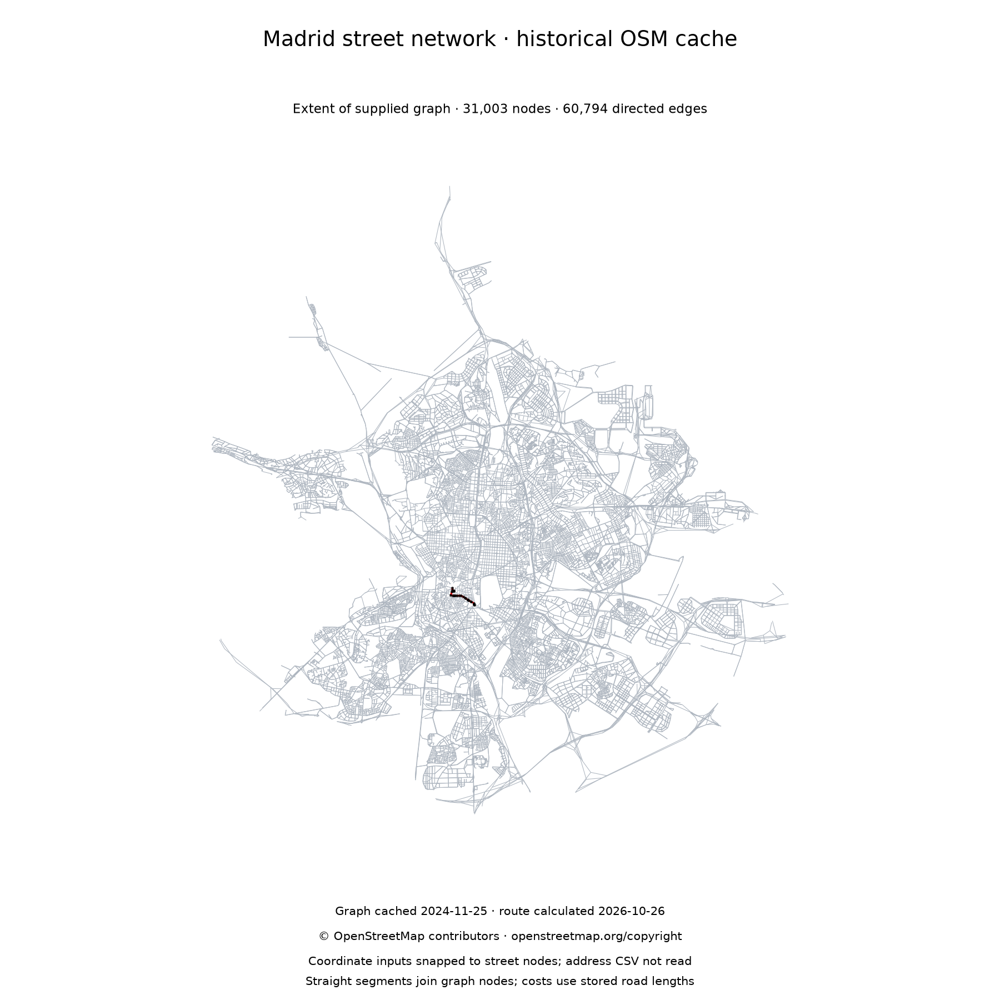

# Discrete mathematics

Three two-person coursework projects at ICAI: a number-theory calculator,
educational RSA and route planning on Madrid's street graph. The mathematical
algorithms are implemented in Python rather than delegated to a computer-algebra
or routing package.

Start with the [Madrid route planner](madrid-route-planner/README.md) for the map
example, or choose one of the smaller command-line projects below.

*The team's Dijkstra implementation runs on an archived OpenStreetMap graph
from 25 November 2024. It represents real streets, not current traffic or driving
conditions. © [OpenStreetMap contributors](https://www.openstreetmap.org/copyright),
[ODbL 1.0](https://opendatacommons.org/licenses/odbl/1-0/).
[Map source and checksum](madrid-route-planner/data/README.md).*

## Projects

| Folder | What it contains | First example |
|---|---|---|
| [madrid-route-planner/](madrid-route-planner/README.md) | Dijkstra routing with three costs, plus Prim and Kruskal for spanning forests | An offline Sol–Atocha graph route: 25 edges and 1,805.254 metres |
| [modular-arithmetic/](modular-arithmetic/README.md) | Primes, factorisation, Bézout identities, modular inverses, congruences and square roots | Factorise an integer or solve a congruence system |
| [rsa-cryptography/](rsa-cryptography/README.md) | Key generation, character encoding, encryption, decryption and attacks on small examples | Encrypt and recover a message, then factor the teaching modulus |

Each folder is self-contained. Follow its README and run commands from that
folder, using Python 3.12 and a separate virtual environment where required.
There is no single application or installation command at the repository root.

## Where to start in the code

- `madrid-route-planner/weighted_graph.py`: graph algorithms.
- `modular-arithmetic/modular.py`: number-theory routines;
  `calculator.py` provides their command-line interface.
- `rsa-cryptography/rsa.py`: RSA and teaching attacks. Its local `modular.py`
  keeps the project independently runnable.

The calculator and RSA application use the standard library; pytest is a test
dependency. Madrid uses NetworkX for graph containers and OSMnx for street-data
access and nearest-node lookup. The routing algorithms and mathematical logic
are the team's implementation, developed from coursework interfaces.

## Scope

The bundled Madrid map example works without a network request. Its separate
address interface needs the municipal address CSV and may contact external map
services; a complete address-to-route run has not been checked end to end.
The model omits current traffic, vehicle access and turn restrictions.

RSA demonstrates textbook encryption and its weaknesses. It must not be used
to protect real data. Each subproject documents its commands, tests and assumptions.
