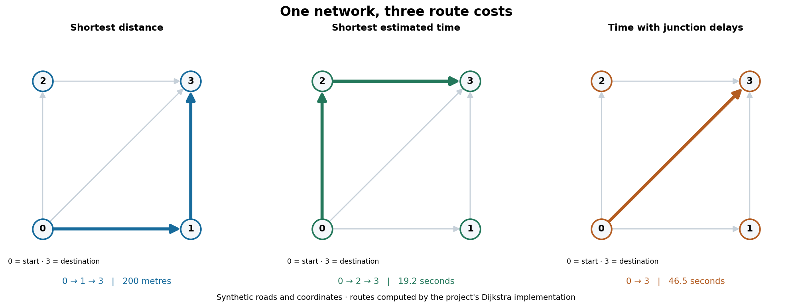

# Discrete mathematics: number theory, RSA and routing

Python implementations of number-theory algorithms, textbook RSA and weighted graph search. The three projects connect mathematical methods with runnable command-line applications and tests.

The route planner computes a different path for each cost on this synthetic network. The roads, coordinates and travel assumptions are invented; the paths are calculated by the project's Dijkstra implementation. Reproduce the figure with `python preview.py` from `madrid-route-planner/`.

| Project | Technical highlights |
| --- | --- |
| [Madrid route planner](madrid-route-planner/README.md) | Dijkstra shortest paths; Prim and Kruskal minimum spanning forests; address lookup; distance and estimated travel-time costs. |
| [Modular arithmetic](modular-arithmetic/README.md) | Primes, Bézout identities, modular inverses, non-coprime congruences and square roots, with a command-line calculator. |
| [RSA cryptography](rsa-cryptography/README.md) | Key generation, Unicode encoding, decimal padding and attacks on small teaching examples. |

## Getting started

Use Python 3.12. Each folder is self-contained, with its own README, example and tests. Run commands from the relevant project folder. Separate virtual environments keep the mapping dependencies apart from the standard-library arithmetic and RSA code.

Start with the [route-planning demo](madrid-route-planner/README.md): it compares the three costs without downloading any data. A journey on Madrid's real network needs an external address CSV and an OpenStreetMap graph. Neither dataset is bundled.

The arithmetic calculator and RSA example need no third-party runtime libraries. Their test suites use `pytest`; the route-planning tests use `unittest`, NetworkX and OSMnx. Each project README includes installation and test commands.

## Academic context and credits

These were three two-person Discrete Mathematics coursework projects on the iMAT degree at ICAI, Universidad Pontificia Comillas. The descriptions refer to the team's work; they do not assign every component to one contributor.

The team implemented the mathematical and graph algorithms using the coursework interfaces. NetworkX provides graph containers; OSMnx provides street-network access and nearest-node lookup. RSA reuses a local copy of the modular arithmetic library so it can run independently.

The code and command names are now in English. Course test cases have been adapted to those names and kept alongside regression tests. The original Spanish command interface is not supported by this version.

The projects include corrections made after submission. Their READMEs explain the relevant changes and limitations. RSA demonstrates the mathematics and weaknesses of textbook encryption; it must not be used to protect real data.
