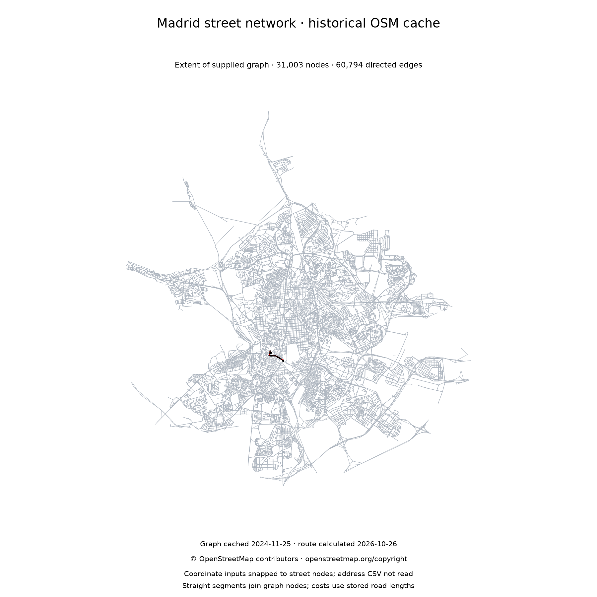
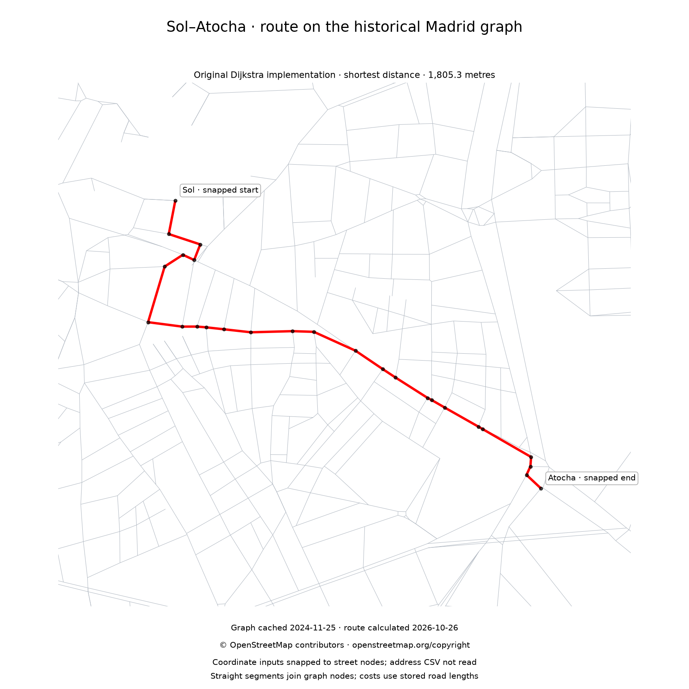

# Madrid route planner

We built this two-person Discrete Mathematics project at ICAI to route between Madrid addresses using our Dijkstra implementation. Routes can minimise distance, estimated travel time or time with a fixed junction penalty. The graph module also implements Prim and Kruskal for minimum spanning forests.

NetworkX supplies graph containers; OSMnx downloads OpenStreetMap streets and finds the nearest graph nodes. The search and spanning-tree algorithms are implemented in [weighted_graph.py](weighted_graph.py).



*Real street-network data, archived on 25 November 2024. The highlighted route
was calculated with our existing Dijkstra implementation. The graph is a
historical snapshot, not a current traffic or road-access service.
© [OpenStreetMap contributors](https://www.openstreetmap.org/copyright),
[ODbL 1.0](https://opendatacommons.org/licenses/odbl/1-0/).
[Data source and checksum](data/README.md).*

## Install

Checked with Python 3.12.2 on macOS and Python 3.12.14. Run from this folder:

```bash
python3.12 -m venv .venv
source .venv/bin/activate
python -m pip install --upgrade pip
python -m pip install -r requirements.txt
```

On Windows, activate with `.venv\Scripts\activate`. The checked environment used pip 26.2.2, OSMnx 1.9.3, NetworkX 3.3, pandas 3.1.0, Matplotlib 3.11.2 and scikit-learn 1.9.1.

## Reproduce the real-map example offline

The compressed graph is included, so this example does not depend on Overpass:

```bash
python scripts/render_cached_madrid.py --output-dir output/madrid-cached
```

The helper verifies the archive, then calls the existing `simplify_graph`,
`distance_cost`, `shortest_path` and `draw_route`. It saves the network overview
and a route close-up. Use a new output directory when repeating the command;
it refuses to replace existing images. This example was executed with
Python 3.12.14 and, separately, Python 3.12.2 on macOS, both using OSMnx 1.9.3.

| Quantity | Result |
| --- | --- |
| Archived input graph | 31,003 nodes and 61,149 directed edges |
| Graph after the project's conversion | 31,003 nodes and 60,794 directed edges |
| Shortest-distance route | 25 edges; 1,805.254 metres |



*New calculation on the historical graph. The criterion is the sum of stored
edge lengths, not travel time. The renderer joins graph nodes with straight
segments; it does not trace every curve in the road geometry.*

Inputs are `(40.41655, -3.7038)` near **Puerta del Sol** and
`(40.4076833, -3.6918472)` near **Atocha**. OSMnx snaps them to the nearest
street nodes, approximately 101 m and 77 m away. Those access distances are
not included in the 1,805.254 m cost: this is a graph route, not door-to-door
navigation. The command does **not** read `addresses.csv` or check current
closures, access conditions or turn restrictions.

## Address input and a fresh street download

For the interactive address workflow, obtain the council directory described in
[Data and model notes](docs/data-and-model.md), save it as `addresses.csv`, then run:

```bash
python route_planner.py
```

Enter a name and number as stored in the directory, for example `Calle Mayor, 1`.
A blank address exits. The programme loads a separate `madrid.graphml` when
present; otherwise it asks OSMnx for Madrid's driving network. That download
needs the external geocoding and Overpass services. It does not automatically
substitute the bundled historical archive for a current street download.

For explicit coordinates and a compatible local graph, the general figure
command remains available:

```bash
python scripts/make_madrid_figure.py --graph /path/to/madrid.graphml \
  --origin 40.41655 -3.7038 --destination 40.4076833 -3.6918472 \
  --cost distance --output output/madrid-distance.png
```

Add `--download` to allow a new network request when the chosen graph is absent.
Live downloads can time out; the bundled example above is the checked offline
alternative. The municipal CSV was checked separately: its 214,676 rows loaded,
and `Calle Mayor, 1` resolved to `(40.4164694, -3.7046556)`. That does not establish
a complete address-to-route run: neither saved real-map figure reads the CSV.

## Small synthetic example

This optional example needs no external data:

```bash
python demo.py
```

It constructs four invented nodes, runs the same routing functions and saves `output/demo-route.png`. Re-running it replaces that image.

| Cost | Computed route | Total |
| --- | --- | --- |
| Distance | `0 → 1 → 3` | 200 metres |
| Estimated travel time | `0 → 2 → 3` | 19.2 seconds |
| Time with junction delays | `0 → 3` | 46.5 seconds |

[View the four-node synthetic comparison](docs/images/route-comparison.png).

The figure is a synthetic teaching example, not Madrid's street network. `python preview.py` reproduces it and replaces `docs/images/route-comparison.png`.

## Methods, tests and limitations

`street_map.py` handles addresses, graph loading and plotting. `route_planner.py` defines the three costs and turns paths into approximate navigation instructions. `weighted_graph.py` contains the mathematical algorithms. Dijkstra uses a heap; Kruskal merges explicit component sets rather than a disjoint-set data structure.

```bash
python -m unittest discover -s tests -v
python graph_example.py
```

The original 22 tests passed with Python 3.12.2 on macOS and Python 3.12.14. The four-node example also ran on macOS and produced the routes and costs above. They compare paths and spanning forests with NetworkX and cover disconnected graphs, mixed node labels, large integer weights, address parsing, GraphML and synthetic plotting. The separate seeded graph example also runs locally. Twelve more tests (`tests/test_dms_ranges.py`, `tests/test_cost_model.py`) cover coordinate ranges, speed units, parallel roads, the interactive choice of cost graph and an empty particle column; all 34 passed on Python 3.12.2 on macOS with pandas 3.1.0 and without the pandas deprecation warning that one original test used to print. The real-map example additionally loaded the archived graph and calculated the coordinate route shown above. The interactive address-to-route workflow remains a separate check.

Travel time assumes travel at the interpreted speed limit, without traffic. The third cost adds 24 seconds to every edge. Parallel roads are reduced to one edge per pair of nodes: the shortest for the distance cost, the fastest for both time costs. Turn instructions use coordinate differences and do not enforce turn restrictions. Missing lengths become zero; speeds are read as km/h unless the text gives mph or knots, a text with any other unit falls back to the road-type table, and conditional limits are not interpreted. See the [data and model notes](docs/data-and-model.md) for details and attribution requirements.

Post-submission fixes already present in this version cover unreachable destinations, short routes, address particles, terminal exit and large weights. The coursework interface is now in English.
