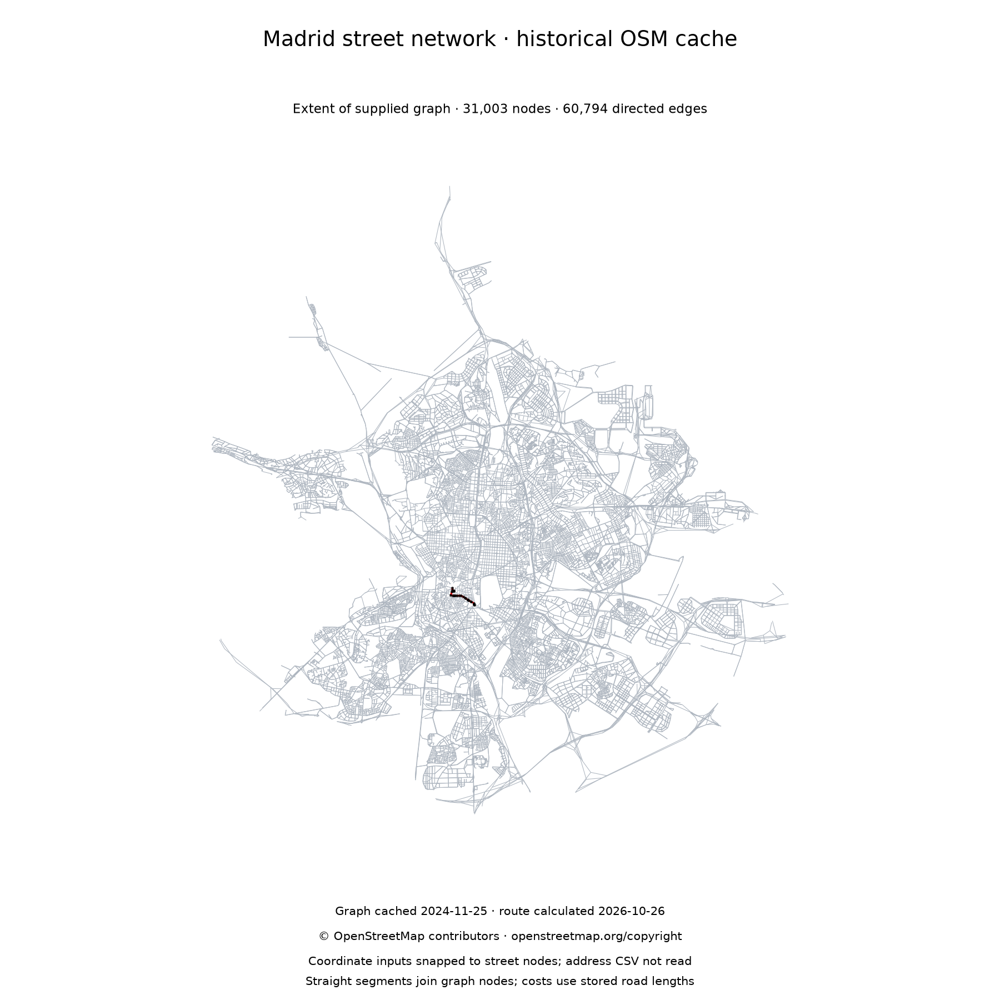
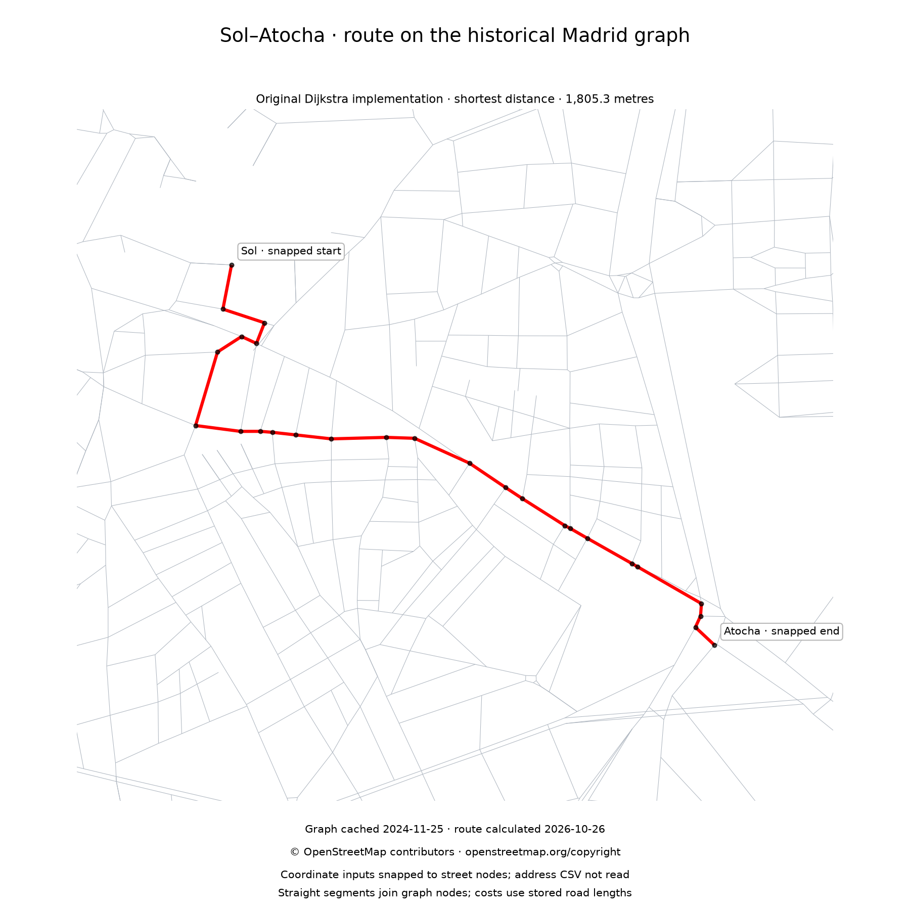

# Madrid route planner

A two-person Discrete Mathematics project at ICAI implementing Dijkstra routing
on Madrid's street graph. Routes can minimise distance, estimated travel time
or time with a fixed junction penalty. The graph module also implements Prim
and Kruskal for minimum spanning forests.

[Run the map example](#how-to-run) · [Other examples](#other-examples) · [Repository structure](#repository-structure)

<a href="docs/images/madrid-cached-network.png"></a>

*An OpenStreetMap driving-network snapshot from 25 November 2024, with the
calculated route highlighted. © [OpenStreetMap contributors](https://www.openstreetmap.org/copyright),
[ODbL 1.0](https://opendatacommons.org/licenses/odbl/1-0/).
[Data source and checksum](data/README.md).*

## How to run

Use Python 3.12 from this folder. The compressed graph is included; this example
needs neither geocoding nor an Overpass request.

```bash
python3.12 -m venv .venv
source .venv/bin/activate
python -m pip install --upgrade pip
python -m pip install -r requirements.txt
python scripts/render_cached_madrid.py --output-dir output/madrid-cached
```

Choose a new output directory for each run. The script checks the archive, calls
the project's routing functions and saves an overview and close-up without
replacing existing images.

| Part of the example | Result |
|---|---|
| Archived input graph | 31,003 nodes; 61,149 directed edges |
| Graph after conversion | 31,003 nodes; 60,794 directed edges |
| Shortest-distance route | 25 edges; 1,805.254 metres |

<a href="docs/images/madrid-sol-atocha-route.png"></a>

*Close-up of the Sol–Atocha route. The cost sums stored edge lengths; the drawing
joins graph nodes with straight segments rather than following every road curve.*

The requested coordinates snap to street nodes about 101 m and 77 m away.
Those access distances are excluded from the cost. This is a route between
graph nodes, not door-to-door navigation or a check of current driving conditions.

## Other examples

`python demo.py` compares the three costs on four invented nodes and writes
`output/demo-route.png`:

| Cost | Route | Total |
|---|---|---|
| Distance | `0 → 1 → 3` | 200 metres |
| Estimated travel time | `0 → 2 → 3` | 19.2 seconds |
| Time with junction delays | `0 → 3` | 46.5 seconds |

[View the synthetic comparison](docs/images/route-comparison.png).
This small example is separate from the real Madrid graph above.

For the address interface, obtain the municipal CSV described in
[Data and model notes](docs/data-and-model.md), save it as `addresses.csv`, then
run `python route_planner.py`. Enter an address in the directory's format, such
as `Calle Mayor, 1`; a blank address exits. This workflow uses a separate
`madrid.graphml` or downloads a graph through OSMnx. It does not automatically
use the bundled historical archive. The complete address-to-route workflow has
not been checked end to end.

## Repository structure

```text
madrid-route-planner/
├── weighted_graph.py            # Dijkstra, Prim and Kruskal; start here
├── street_map.py                # Address loading, graph access and plotting
├── route_planner.py             # Three costs and approximate navigation instructions
├── demo.py                      # Small cost comparison
├── graph_example.py             # Small graph example
├── preview.py                   # Plot of the demo network
├── requirements.txt
├── scripts/
│   ├── render_cached_madrid.py  # Offline historical-map example
│   └── make_madrid_figure.py    # Coordinate-based route figure
├── data/                        # Attributed graph archive and its README
├── docs/
│   ├── data-and-model.md        # Address schema, graph conversion and model notes
│   └── images/                  # Figures
└── tests/                       # Routes, forests, addresses and cost-model cases
```

NetworkX supplies graph containers; OSMnx supplies data access and nearest-node
lookup. The team implemented the graph algorithms and routing logic.

## Tests and model limits

```bash
python -m unittest discover -s tests -v
```

Tests compare paths and spanning forests with NetworkX and cover disconnected
graphs, mixed labels, GraphML, plotting and cost-model edge cases.

- The map is historical. There is no live traffic, current access check or
  enforcement of turn restrictions.
- Travel time uses interpreted speed limits and fallbacks. The third cost adds
  24 seconds to every traversed edge, regardless of signal locations.
- Parallel roads reduce to the shortest edge for distance or fastest edge for
  time. Missing lengths become zero and can produce misleading routes.
- Dijkstra needs non-negative costs; Prim and Kruskal are for undirected graphs.

[Data and model notes](docs/data-and-model.md) cover the address schema, graph
conversion, speed assumptions and other rendering commands.
